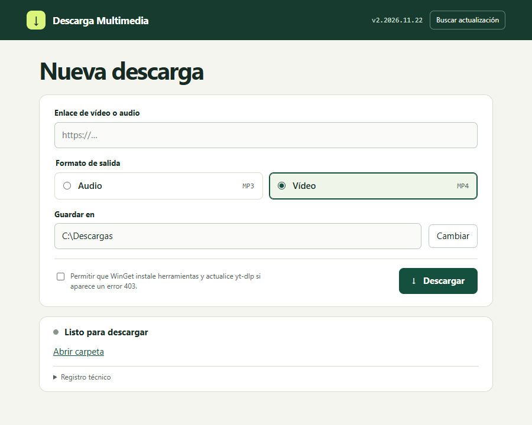

# Descarga Multimedia

Descarga audio en **MP3** o vídeo en **MP4** desde YouTube y otros sitios compatibles con yt-dlp. La aplicación está en español y se abre en Windows con una interfaz HTML local basada en WebView2.

**[Descargar DescargaMultimedia.exe](https://github.com/davidmotog/descarga-multimedia/releases/latest/download/DescargaMultimedia.exe)** · [Ver las notas de la última versión](https://github.com/davidmotog/descarga-multimedia/releases/latest)



## Requisitos

- **Windows** con Microsoft Edge WebView2 Runtime. Si la ventana indica que falta, instala [WebView2 Runtime desde Microsoft](https://developer.microsoft.com/microsoft-edge/webview2/).
- **yt-dlp y FFmpeg** para la descarga y la conversión. Para los enlaces de YouTube, la aplicación también comprueba **Deno**.
- **WinGet** si quieres que la aplicación instale las herramientas que falten. Activa la casilla correspondiente antes de descargar. Si la dejas desmarcada, el registro indica cómo instalar cada herramienta manualmente.

## Cómo se usa

1. Abre `DescargaMultimedia.exe` y pega el enlace HTTP o HTTPS del audio o vídeo.
2. Selecciona **Audio** para guardar un MP3 o **Vídeo** para guardar un MP4.
3. Revisa la ruta en **Guardar en**. Usa **Cambiar** para elegir otra carpeta.
4. Pulsa **Descargar**. La ventana muestra el progreso y, al finalizar, ofrece **Abrir archivo**. También puedes usar **Abrir carpeta** para ver lo descargado.

El nombre del archivo incluye el título y el identificador del contenido. La disponibilidad depende del sitio y del enlace. Usa la aplicación con contenido propio o que tengas permiso para descargar. [Consultar los sitios compatibles con yt-dlp](https://github.com/yt-dlp/yt-dlp/blob/master/supportedsites.md)

## Actualizaciones y errores de descarga

- **Actualizar la aplicación.** La versión aparece arriba a la derecha con el formato `2.año.mes.día`. **Buscar actualización** consulta GitHub y ofrece un enlace si hay una versión posterior.
- **Resolver un error HTTP 403.** Si activas la casilla de WinGet y se produce ese error, la aplicación busca una actualización de yt-dlp. Cuando detecta que ha cambiado la versión activa, reintenta la descarga una vez.
- **Ver qué ha fallado.** Despliega **Registro técnico** y revisa el mensaje del sitio o de la herramienta. Para los problemas específicos de YouTube, consulta la [guía oficial de yt-dlp sobre Deno](https://github.com/yt-dlp/yt-dlp/wiki/EJS).

Si instalaste yt-dlp con WinGet, puedes actualizarlo también desde PowerShell.

```powershell
winget upgrade --id yt-dlp.yt-dlp --exact
```

## Compilar desde el código fuente

Abre Windows PowerShell 5.1 en la carpeta del repositorio, en un equipo con .NET Framework 4.8. Ejecuta el siguiente comando para generar `DescargaMultimedia.exe`.

```powershell
.\Compilar.ps1
```

La compilación descarga el SDK de WebView2 desde NuGet, verifica su SHA-256 e incorpora al ejecutable las bibliotecas, la interfaz HTML y el motor de descarga. También puedes ejecutar `.\DescargaMultimedia.ps1` para abrir la aplicación y compilarla cuando haga falta.

## Verificar la descarga

Calcula el SHA-256 del ejecutable y compáralo con el valor de [SHA256SUMS.txt](https://github.com/davidmotog/descarga-multimedia/releases/latest/download/SHA256SUMS.txt) de la misma publicación.

```powershell
Get-FileHash .\DescargaMultimedia.exe -Algorithm SHA256
```
